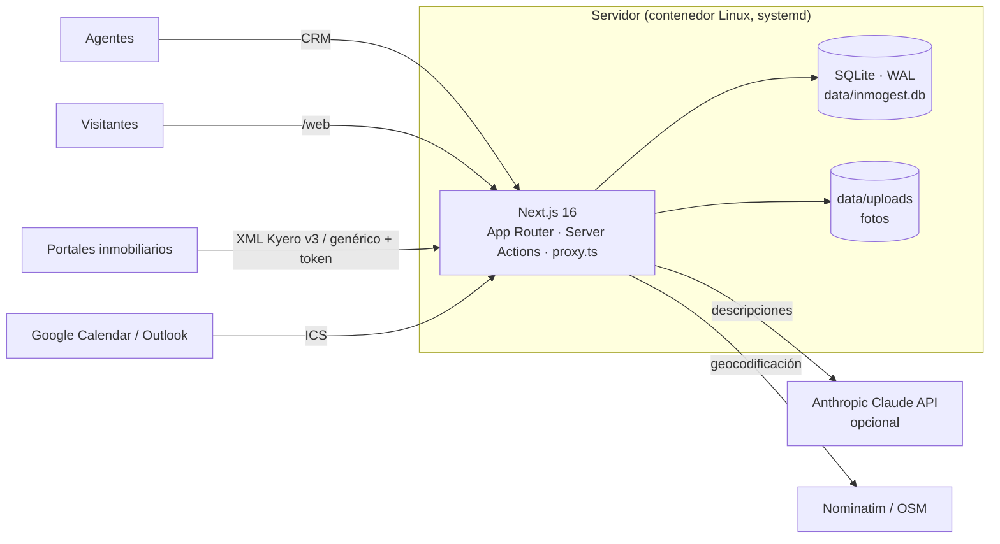

# Inmogest: CRM inmobiliario

**CRM completo para agencias inmobiliarias —propiedades, captaciones, clientes con cruces automáticos, agenda, facturación, feeds para portales y web pública— que funciona en local con Next.js 16 y SQLite, sin servicios externos obligatorios.**


---

## Visión general

Inmogest cubre el día a día de una agencia inmobiliaria en una sola aplicación: desde captar un inmueble y publicarlo en portales hasta cruzarlo con la demanda de los clientes, agendar visitas con parte firmado, facturar los honorarios y mostrarlo en la web pública de la agencia. Todo el estado vive en un único fichero SQLite (`data/inmogest.db`) y las fotos en `data/uploads`, lo que permite desplegarlo en un contenedor de 512 MB.

## Módulos

| Sección | Qué hace |
|---|---|
| Vista general | Llamadas, reuniones, visitas y firmas del día, tareas, mini calendario, gráfico de captaciones por agente e ingresos estimados y facturados. Filtros por agente y fechas, e informe en CSV o PDF. |
| Propiedades | Listado y cuadrícula con filtros avanzados, ficha con pestañas (fotos, mapa, portales, cruces, visitas y actividad), alta y edición con mapa y geolocalización, generador de descripciones, cambio de estado, duplicado, ficha imprimible y mapa general. |
| Captaciones | Tablero kanban por etapas (arrastrar y soltar), ratio de éxito, valoración rápida y conversión en propiedad. |
| Propiedades compartidas | Bolsa de colaboración con reparto de honorarios y solicitud de colaboración al agente. |
| Portales inmobiliarios | Activación por portal, matriz de publicación inmueble × portal y URL de exportación XML con token (Kyero v3 o genérico). |
| Clientes | Fichas con demanda (operación, presupuesto, zonas, tipos y extras) y cruces automáticos con puntuación. También vista de demandas, agenda, mensajes, visitas y facturas por cliente. |
| Mensajes | Bandeja de consultas que llegan de la web, portales y equipo, con respuestas rápidas y notas internas. Permite crear un cliente desde un mensaje. |
| Calendario y tareas | Vistas de mes, semana, día y agenda, con arrastrar para reprogramar, recordatorios en el navegador y exportación ICS (Google Calendar u Outlook). |
| Facturas | Series con numeración automática, borradores, emisión, cobro, anulación, rectificativas, impresión en PDF y exportación CSV. |
| Tasador | Valoración por comparables (mediana de €/m²) con informe imprimible. |
| Partes de visita | Hoja de visita con firma digital en pantalla e impresión. |
| Agentes | Usuarios, roles (administrador o agente), permisos y estadísticas por agente. |
| Página web | Web pública en `/web` con portada, buscador, mapa, ficha con galería, favoritos, simulador de hipoteca, formulario de contacto (llega a Mensajes y crea el cliente), empresa y contacto. Los colores, el logo y los textos se configuran desde el CRM. |

## Aspectos técnicos destacados

- **Descripciones con IA** — `src/lib/ai.ts` genera anuncios en español o inglés con la API de Claude (Anthropic SDK) a partir de los datos de la ficha, con instrucciones para no inventar datos; si no hay `ANTHROPIC_API_KEY` o la llamada falla, recurre a una plantilla determinista.
- **Cruces cliente ↔ inmueble** — `src/lib/matching.ts`: filtros duros (operación, presupuesto, zonas, tipo) más puntuación 0–100 con los motivos del cruce.
- **Feeds XML para portales** — formato Kyero v3 y genérico, protegidos por token por portal (`/feeds/[portal]`).
- **Geocodificación y mapas** — Nominatim (OpenStreetMap) vía `/api/geocode` y mapas con Leaflet.
- **Autenticación propia** — contraseñas con scrypt y comparación en tiempo constante, sesiones en cookie (flag `Secure` salvo `INSECURE_COOKIES=1`), guardas por rol en Server Actions y `proxy.ts`.
- **Documentos imprimibles** — facturas, fichas, tasaciones, partes de visita e informes bajo `/print/*`, listos para "Guardar como PDF".
- **SQLite en modo WAL** con Drizzle ORM (20 tablas) y migraciones SQL en `drizzle/`.

## Arquitectura



## Stack técnico

| Capa | Tecnología |
|---|---|
| Framework | Next.js 16 (App Router, Turbopack, Server Actions), React 19 |
| Lenguaje | TypeScript |
| Datos | SQLite (`better-sqlite3`), Drizzle ORM + Drizzle Kit |
| UI | Tailwind CSS v4, Lucide, Recharts, Leaflet / React Leaflet |
| Validación | Zod 4 |
| Fechas | date-fns |
| IA | `@anthropic-ai/sdk` (opcional) |

## Puesta en marcha

Requisitos: Node.js 22 y pnpm.

```bash
pnpm install
cp .env.example .env.local   # opcional: ANTHROPIC_API_KEY, APP_URL
pnpm reset                   # crea data/inmogest.db con datos de demostración (borra los datos existentes)
pnpm dev                     # http://localhost:3000
```

Los usuarios de demostración (un administrador y varios agentes) los crea el script de semilla (`scripts/seed.ts`). Todos los datos de demostración (clientes, propiedades, facturas) son ficticios y se generan aleatoriamente.

| Script | Para qué |
|---|---|
| `pnpm dev` / `pnpm build` / `pnpm start` | Desarrollo, build de producción, servir build |
| `pnpm reset` | Borra la base de datos y la vuelve a sembrar con datos de demostración |
| `pnpm seed` | Siembra datos de demostración |
| `pnpm run init` | Base de datos limpia de producción (agencia, un administrador, portales y series de factura) |
| `pnpm db:generate` | Genera una migración a partir del esquema |
| `pnpm lint` · `pnpm typecheck` | Calidad |

### Variables de entorno

| Variable | Descripción |
|---|---|
| `APP_URL` | URL pública usada en los feeds de portales (enlaces absolutos a fotos y fichas). Por defecto, el host de la petición. |
| `ANTHROPIC_API_KEY` | Opcional: activa las descripciones con IA. Sin ella se usa una plantilla. |
| `INSECURE_COOKIES` | `1` solo si se sirve producción por HTTP sin TLS (desactiva el flag `Secure` de la cookie). |

## Despliegue

Producción con una base de datos limpia:

```bash
ADMIN_EMAIL=tu@email.com ADMIN_NAME="Tu Nombre" pnpm run init   # contraseña generada en data/admin-password.txt (chmod 600)
pnpm build
pnpm start                                                  # INSECURE_COOKIES=1 solo si se sirve por HTTP sin TLS
```

`scripts/deploy.sh [usuario@host]` compila en local (el contenedor de 512 MB no puede compilar), sincroniza con `rsync` a `/opt/inmogest` excluyendo `data/`, instala dependencias de producción, reinicia el servicio systemd `inmogest` y comprueba que `/login` responde.

## Notas

- Las fotos se guardan en `data/uploads` y se sirven desde `/files/...`. Todo `data/` está fuera de git.
- La publicación real en Idealista, Fotocasa y otros portales requiere un acuerdo con cada portal. Hay que facilitarles la URL XML que aparece en *Portales inmobiliarios*.

## Estructura del proyecto

```
inmogest-crm/
├── src/
│   ├── app/
│   │   ├── (app)/          # CRM: dashboard, propiedades, captaciones, clientes, mensajes,
│   │   │                   # calendario, tareas, facturas, tasador, partes-visita, agentes, ajustes
│   │   ├── (auth)/login/
│   │   ├── api/            # geocode, ia/descripcion, calendario.ics, export, informes, public/*
│   │   ├── feeds/[portal]/ # XML para portales
│   │   ├── print/          # documentos imprimibles
│   │   └── web/            # web pública de la agencia
│   ├── components/         # formularios, kanban, calendario, mapas, gráficos, firma
│   ├── db/                 # esquema Drizzle + conexión SQLite
│   ├── lib/                # ai, matching, valuation, feeds, ics, csv, auth, queries
│   └── proxy.ts
├── drizzle/                # migraciones SQL
├── scripts/                # seed, reset, init, deploy.sh
└── data/                   # BD SQLite y fotos (no versionado)
```

---

© 2026 Gabriel Huertas. All rights reserved. Source shown for portfolio purposes.
